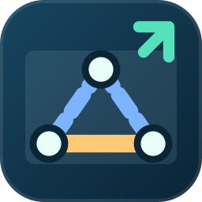
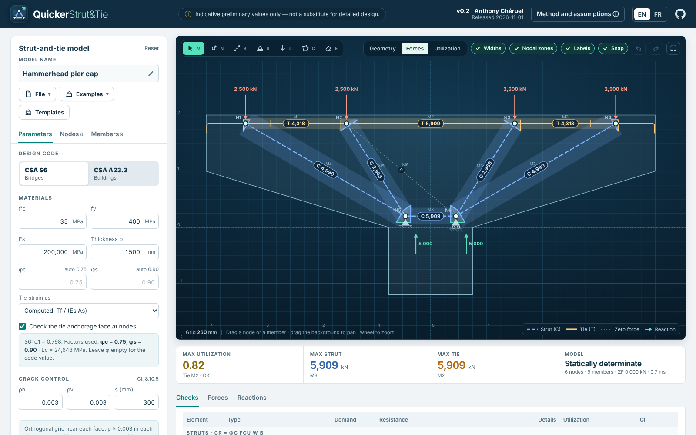
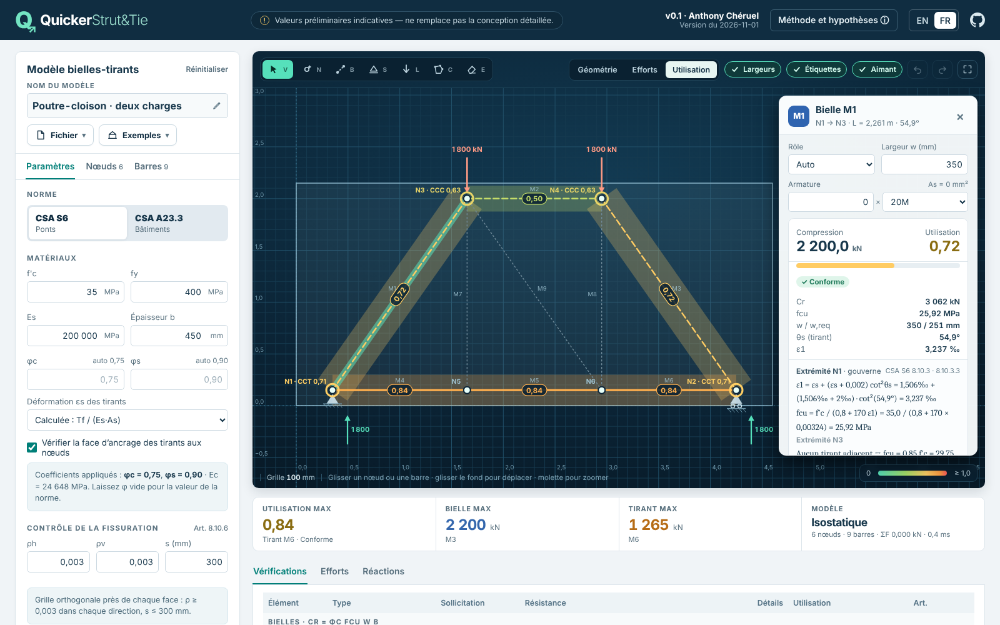
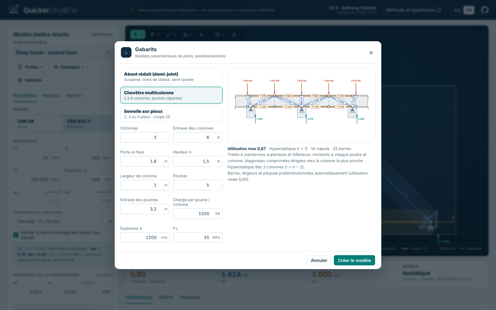
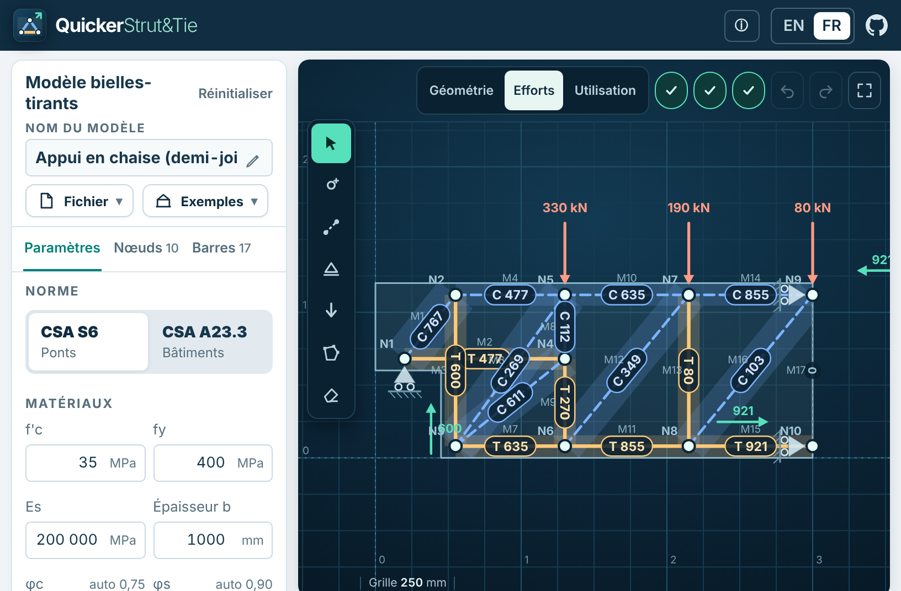

# QuickerStrut&Tie

**Interactive 2D strut-and-tie models checked to CSA S6 and CSA A23.3, in your browser.**
Draw the concrete outline, place nodes and members, drag them around and watch the
forces, strut and tie resistances and nodal zone stresses update live.
No installation, no server, no data leaves your computer.

**▶ Open the app: https://acheruel.github.io/QuickerStrut-Tie/**



*Version 0.2.5 · 2026-11-01 · Anthony Chéruel · [Version history](CHANGELOG.md) · [Français](#en-français)*

## What it does

- **Interactive editor:** select, node, member, support, load, outline and erase tools;
  drag nodes, members or outline vertices with grid snapping; zoom, pan, undo/redo,
  keyboard shortcuts, touch support.
- **Live analysis:** pin-jointed truss solved by the direct stiffness method at every
  change (a few milliseconds); struts and ties identified from the force sign; mechanism
  detection with the free node named; determinate and indeterminate models.
- **CSA checks:** strut crushing with the ε1-based limit (≤ 0.85 f′c to A23.3, ≤ α1 f′c to
  S6), tie yielding, CCC / CCT / CTT nodal zone stresses on strut, bearing and anchorage
  faces, **tie anchorage** (available length to the extended nodal zone vs. straight-bar or
  hook development length; plates, welded bars, closed stirrups, continuous or bent
  bars), crack control
  reinforcement; CSA S6 (bridges) or CSA A23.3 (buildings) factors, overridable.
- **Hydrostatic nodal zones drawn graphically:** the force polygon rotated by 90° gives each
  node's outline, every face perpendicular to its force and at the same stress; the
  hydrostatic face widths are compared with the widths entered and a zone that leaves the
  concrete is flagged.
- **Parametric bridge templates:** dapped end (half-joint), multi-column bent cap (2 to 4
  columns, any number of girders) and pile cap on 2, 3 or 4 piles, generated and **sized
  automatically** (bars, strut widths, plates, anchorage type); the sizing is also
  available for any model.
- **QuickerPile link:** factored pile head loads (N, H, M per pile, 3D pile caps expanded)
  exported as a `quickerpile-head-loads` JSON file.
- **Readable results:** forces and utilization views drawn with the real strut and tie
  widths, colour **and** line style (dashed struts, solid ties) with value labels; an
  inspector showing every step of each calculation; checks, forces and reactions tables.
- **Outputs:** printable calculation note (PDF through the browser) with nodal zones,
  anchorages and pile loads, SVG drawing, CSV table, `.quickerstrut.json` projects,
  pile head loads for QuickerPile, automatic local save.
- **Examples:** deep beams, double corbel, hammerhead pier cap, half-joint seat
  (dapped end), two-pile cap, **bridge pier corbel**, **integral abutment end diaphragm**
  (deck–abutment corner), and three published examples whose member forces are
  reproduced: FHWA deep beam, Paultre (2011) double corbel and the CAC Handbook
  dapped-end beam (24 forces).
- **French and English** interface; works on desktop, tablets and foldables (including a
  Galaxy Z Fold unfolded in landscape).







## Use it

- **Web:** open the link above in a recent Chrome, Edge, Firefox or Safari.
- **Offline:** download `QuickerStrut-Tie-v<version>-<date>.html` from the repository root
  and double-click it. Everything is inside this single file; no Internet connection is
  needed.

| Key | Action | Key | Action |
| --- | --- | --- | --- |
| `V` | Select / drag | `C` | Edit the concrete outline |
| `N` | Add a node (on a member: split it) | `E` | Erase |
| `B` | Draw members (chain, `Esc` to stop) | `1` `2` `3` | Geometry / forces / utilization |
| `S` | Cycle the support type | `F` | Fit the view |
| `L` | Load a node | arrows | Nudge the selection by one grid step |
| `Ctrl Z` / `Ctrl Y` | Undo / redo | `Ctrl S` / `Ctrl O` / `Ctrl P` | Save / open / report |

Hold `Alt` while dragging to disable snapping; hold `Space` or use the middle button to pan
in any tool.

> **Indicative preliminary values only — not a substitute for detailed design.**
> The model geometry is the engineer's judgement. Clause numbers and factors must be
> confirmed against the edition of the standard that applies to the project. The author
> cannot be held liable for the results.

Method: [METHOD.md](METHOD.md) · Validation against hand calculations and published
examples: [VALIDATION.md](VALIDATION.md)

## Development

Plain HTML, CSS and JavaScript with no dependencies and no build step for the web version.

```text
app/index.html        page
app/css/app.css       styles (screen and printed report)
app/js/solver.js      truss solver (stiffness method)          ← unit tested
app/js/csa.js         CSA S6 / A23.3 checks, bar sizes         ← unit tested
app/js/examples.js    example models
app/js/templates.js   parametric templates, automatic sizing, pile loads ← unit tested
app/js/i18n.js        French / English strings and method text
app/js/app.js         state, history, storage, formatting
app/js/canvas.js      SVG editor, drawing and interactions
app/js/panels.js      side panel, inspector, metrics, tables
app/js/report.js      printable report and CSV export
app/js/main.js        start-up, menus, files, shortcuts
tests/                node --test suites
build.py              builds the portable single-file HTML
```

```bash
node --test                 # engine and translation tests
python3 -m http.server -d app      # serve the app at http://localhost:8000
python3 build.py                   # rebuild the dated portable HTML and index.html
```

GitHub Pages serves the repository root (**Settings → Pages**: *Deploy from a branch*,
`main`, `/ (root)`). `build.py` writes the portable page twice: the dated download
`QuickerStrut-Tie-v<version>-<date>.html` and `index.html`, which Pages serves at
https://acheruel.github.io/QuickerStrut-Tie/ (`.nojekyll` keeps Jekyll from rendering the
README instead). Run `python build.py` before every commit; `python build.py --check`
fails if either file is stale.

---

## En français

**Modèles bielles-tirants 2D interactifs, vérifiés selon CSA S6 et CSA A23.3, dans le navigateur.**
Dessinez le contour du béton, placez les nœuds et les barres, déplacez-les à la souris :
efforts, résistances des bielles et tirants et contraintes des zones nodales se mettent à
jour en direct. Aucune installation, aucun serveur, aucune donnée transmise.

- **Gabarits paramétriques de ponts :** about réduit, chevêtre multicolonne (2 à 4 colonnes),
  semelle sur 2, 3 ou 4 pieux, générés et **prédimensionnés automatiquement** ; export des
  charges en tête de pieu vers **QuickerPile**.
- **Zones nodales hydrostatiques** construites graphiquement (polygone des forces tourné de
  90°) et **vérification de l’ancrage** des tirants (longueur disponible jusqu’à la zone
  nodale prolongée contre l_d ou l_dh ; plaques, barres soudées, étriers fermés).
- **Éditeur :** outils sélection, nœud, barre, appui, charge, contour et effacer ;
  aimantation à la grille, zoom, déplacement, annuler/rétablir, raccourcis clavier, tactile.
- **Calcul en direct :** treillis articulé résolu par la méthode des rigidités à chaque
  modification ; bielles et tirants identifiés par le signe de l’effort ; détection des
  mécanismes ; modèles isostatiques ou hyperstatiques.
- **Vérifications CSA :** écrasement des bielles (fcu basé sur ε1), plastification des
  tirants, zones nodales CCC / CCT / CTT, armature de contrôle de la fissuration ;
  coefficients S6 (ponts) ou A23.3 (bâtiments), modifiables.
- **Résultats lisibles :** largeurs réelles des bielles et tirants, couleur **et** type de
  trait, étiquettes de valeurs ; inspecteur détaillant chaque étape de calcul ; tableaux.
- **Exemples :** poutres-cloisons, corbeau double, chevêtre en porte-à-faux, **appui en
  chaise (demi-joint)**, semelle sur deux pieux, **corbeau de pile de pont**, **culée
  intégrale (diaphragme d’about)**, et trois exemples publiés dont les efforts sont
  reproduits : poutre-cloison FHWA, console courte double de Paultre (2011) et poutre à
  about réduit du manuel CAC (24 efforts).
- **Sorties :** note de calcul imprimable (PDF), dessin SVG, tableau CSV, projets
  `.quickerstrut.json`, sauvegarde locale automatique.
- **Utilisation hors ligne :** téléchargez `QuickerStrut-Tie-v<version>-<date>.html` et
  ouvrez-le ; tout est dans ce fichier.

> **Valeurs préliminaires indicatives — ne remplace pas la conception détaillée.**
> La géométrie du modèle relève du jugement de l’ingénieur. Les numéros d’article et
> coefficients sont à confirmer avec l’édition de la norme applicable. L’auteur ne peut
> être tenu responsable des résultats.

## Licence

QuickerStrut&Tie is free software: you can redistribute it and/or modify it under the terms
of the **GNU General Public License** as published by the Free Software Foundation, either
version 3 of the License, or (at your option) any later version. It is distributed in the
hope that it will be useful, but WITHOUT ANY WARRANTY; without even the implied warranty of
MERCHANTABILITY or FITNESS FOR A PARTICULAR PURPOSE. See [LICENSE](LICENSE).

Logiciel libre sous licence **GPL-3.0-or-later** · © 2026 Anthony Chéruel
